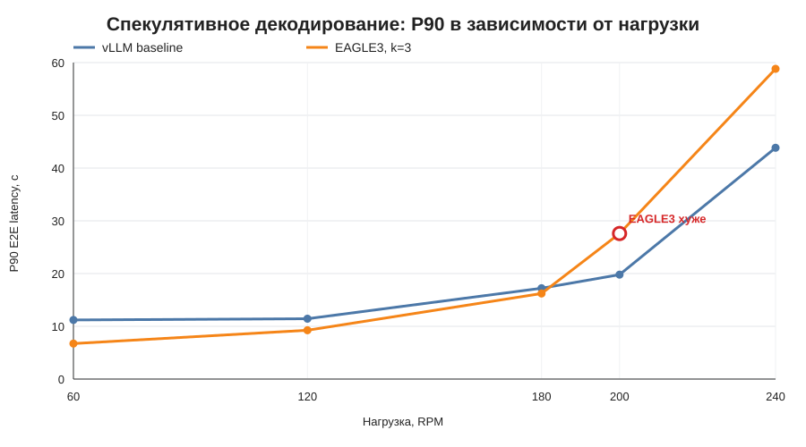
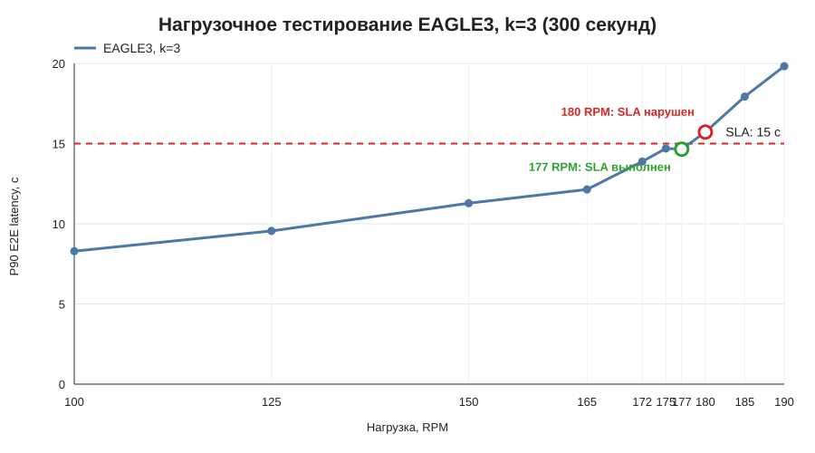

# ДЗ 6. Ускорение инференса

## Сетап

Целевая модель — `Qwen/Qwen3-8B`, движок — vLLM 0.22.0, одна A100. Использовались фиксированные `data/requests.jsonl`, температура `0`, seed `42`, максимум `512` новых токенов, без reasoning. Перед каждым измерением очищался prefix cache. Метрики AIPerf: средняя и P90 **Request Latency**

## 1. Уменьшение latency при 120 RPM

Для каждого запуска отправлялись 640 запросов после 40 warmup-запросов. Ускорение: `S = mean_latency_baseline / mean_latency_config`.

| Конфигурация | Изменение относительно baseline | Mean latency, с | P90, с | S |
|---|---|---:|---:|---:|
| Baseline | дефолтный vLLM | 7.824 | 11.291 | 1.00x |
| Batch tokens 4096 | `--max-num-batched-tokens 4096` | 7.841 | 11.284 | 1.00x |
| Batch tokens 8192 | `--max-num-batched-tokens 8192` | 7.825 | 11.297 | 1.00x |
| EAGLE3 k=3 | до 3 speculative-токенов | **5.477** | **9.328** | **1.43x** |
| EAGLE3 k=5 | до 5 speculative-токенов | 6.005 | 10.443 | 1.30x |
| EAGLE3 k=3 + async | k=3 и `--async-scheduling` | 5.481 | 9.496 | 1.43x |

### Выбор параметров

В baseline средняя TTFT составила 0.137 с, а средняя decode duration — 7.687 с из 7.824 с полного запроса. Поэтому проверялись параметры, способные повлиять на batching prefill и прежде всего на decode: бюджет batched tokens, speculative decoding с двумя значениями `k` и async scheduling.

`max-num-seqs`, утилизация GPU и параметры KV-cache не проверялись отдельно: они увеличивают допустимую ёмкость сервера, но не ускоряют один decode-шаг; при заданной нагрузке узким местом был именно decode. Chunked prefill, prefix caching, `torch.compile` и CUDA graphs уже были включены в дефолтном vLLM, поэтому их отключение не являлось перспективным способом уменьшить latency.

Изменение бюджета batched tokens не дало эффекта. EAGLE3 уменьшил decode duration за счёт предложений draft-модели, которые проверяет основная модель. При `k=5` стоимость лишних предложений стала выше выигрыша; async scheduling также не улучшил результат. Лучшая конфигурация — EAGLE3 с `k=3` без async scheduling.

## 2. Спекулятивное декодирование при разной нагрузке

Для каждой точки использовались те же 640 запросов и 40 warmup-запросов. На графике и в таблице показан P90.

| RPM | Baseline P90, с | EAGLE3 k=3 P90, с |
|---:|---:|---:|
| 60 | 11.206 | 6.735 |
| 120 | 11.435 | 9.258 |
| 180 | 17.222 | 16.219 |
| 200 | 19.795 | 27.586 |
| 240 | 43.847 | 58.821 |

До 180 RPM EAGLE3 быстрее baseline. При 200 RPM он становится хуже: обе модели уже конкурируют за GPU, а speculative decoding добавляет вычисления draft-модели и проверку кандидатов. Точка смены находится между 180 и 200 RPM; первая измеренная точка, где EAGLE3 хуже, — 200 RPM.

## 3. Нагрузочное тестирование

Использовалась лучшая конфигурация EAGLE3 k=3 и `load_test.sh`: каждая нагрузка поддерживалась 300 секунд. SLA: `P90 E2E latency < 15 с`.

| RPM | Mean latency, с | P90, с | SLA |
|---:|---:|---:|---|
| 100 | 5.008 | 8.292 | выполнен |
| 125 | 5.670 | 9.551 | выполнен |
| 150 | 6.748 | 11.281 | выполнен |
| 165 | 7.551 | 12.140 | выполнен |
| 172 | 8.401 | 13.882 | выполнен |
| 175 | 8.737 | 14.694 | выполнен |
| **177** | **8.953** | **14.651** | **выполнен** |
| 180 | 9.544 | 15.719 | нарушен |
| 185 | 10.939 | 17.931 | нарушен |
| 190 | 12.027 | 19.828 | нарушен |

Максимальная проверенная нагрузка, удовлетворяющая SLA, — **177 RPM**. При 180 RPM P90 уже равен 15.719 с и ограничение нарушается. Небольшая разница P90 между 175 и 177 RPM относится к вариативности набора запросов; граница SLA однозначно находится между 177 и 180 RPM.

## Итог

Для фиксированных 120 RPM EAGLE3 k=3 уменьшил среднюю latency с 7.824 до 5.477 с, то есть дал ускорение **1.43x**. При росте нагрузки преимущество speculative decoding исчезает после 180 RPM. Лучшая конфигурация выдерживает 177 RPM в 300-секундном нагрузочном тесте при P90 ниже 15 секунд.
